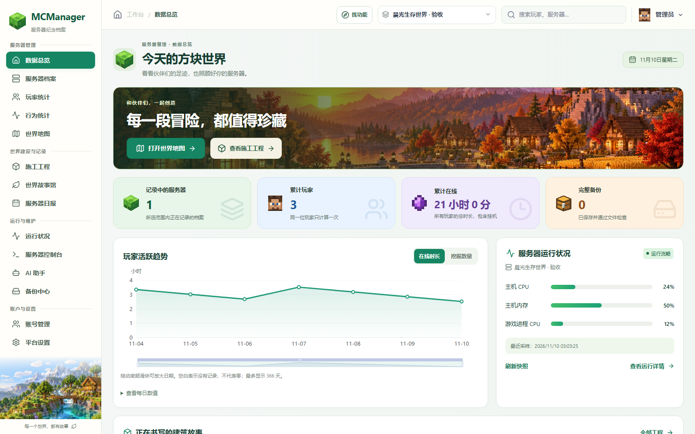

# MCManager Archive

**A self-hosted memory of your Minecraft Bedrock world.**

[中文](README.md) · [Getting started](docs/getting-started.md) · [Architecture](docs/architecture.md) · [Contributing](CONTRIBUTING.md)



Track player activity, preserve construction history, explore your world and give an AI agent permission-scoped access to recorded facts.

- Multi-server archives, player profiles, chat history and daily reports.
- Construction projects with all-player contributions, materials, public maps and frozen phases.
- 3D building previews, remembered height ranges and administrator-only GLB export.
- Fourteen visualization types, grouped by daily life, collaboration and exploration.
- Whole-host and game-process monitoring, world-only backups and daily schedules.
- A stdio MCP server for statistics, world observations, containers and seed predictions.
- An optional `/ai` bridge to an existing DSH / QQ group session.
- Responsive navigation, feature search and deferred chart/model loading.

## Run the platform

Requires Docker Compose v2 and Python 3 for initial configuration:

```sh
python3 scripts/configure.py --public-url http://localhost:8088
docker compose up -d --build
```

Open `http://localhost:8088`. Generated administrator credentials stay in `.env`. The platform starts empty: configure a compatible game collector separately. Initial builds download pinned external resources and can take time.

## Preview status

This is **0.7.0-preview.2**. The native collector targets exact Windows BDS builds, primarily **1.26.61.1**. The retained 1.26.51.1 profile has a smaller feature set. It is not a generic plugin for all future Bedrock releases.

Recorded observations have timestamps and coverage limits; seed predictions are not live-world scans. Structure locations are candidates. Custom resource packs and every possible model are not guaranteed. Test the DSH bridge with your own environment before enabling it for players.

See the [compatibility matrix](docs/compatibility.md), [performance boundaries](docs/performance.md) and [verification guide](docs/testing.md). Screenshots use synthetic data and themed artwork, not production worlds.

## License

Original code: [MIT](LICENSE). Third-party libraries, game assets and trademarks retain their own terms; see [Third-party notices](THIRD_PARTY_NOTICES.md). This project is not an official Minecraft product and is not affiliated with Mojang or Microsoft.

Issues, reproducible bug reports, translations and pull requests are welcome. If the project helps your community, a star is appreciated.
