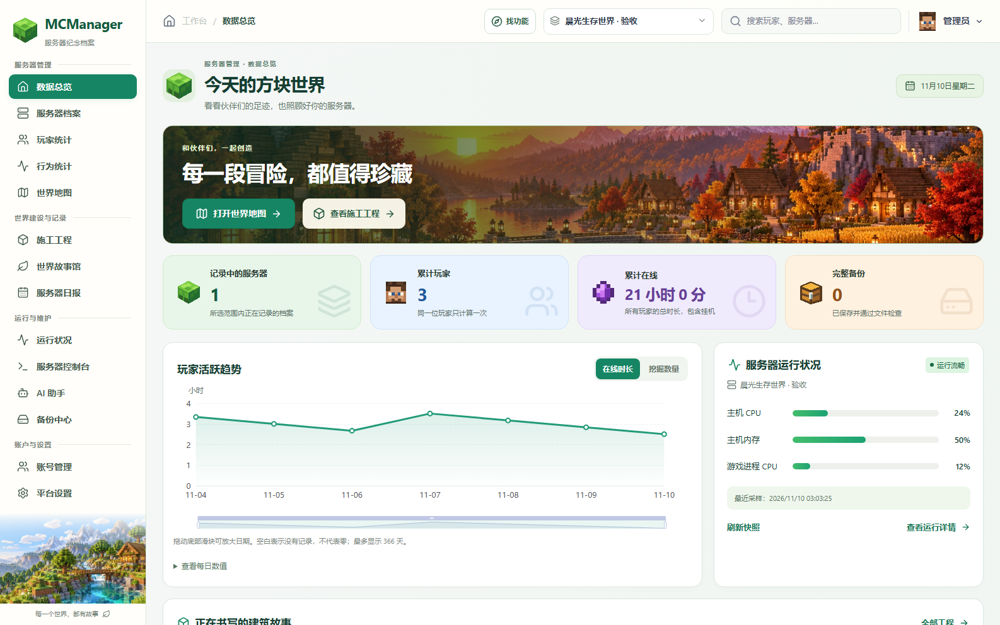
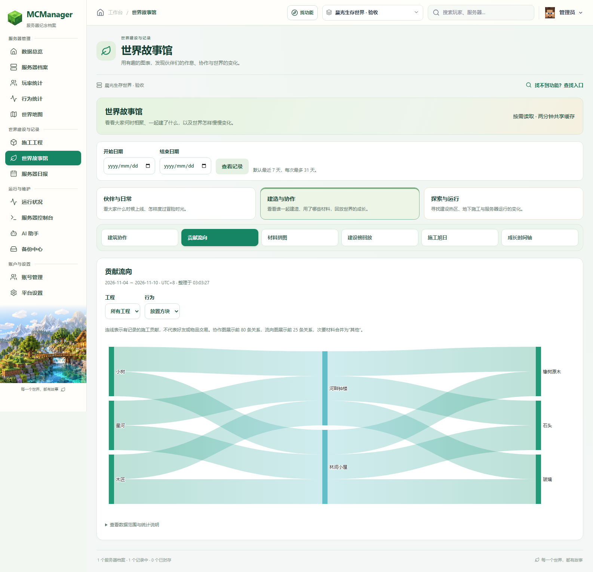
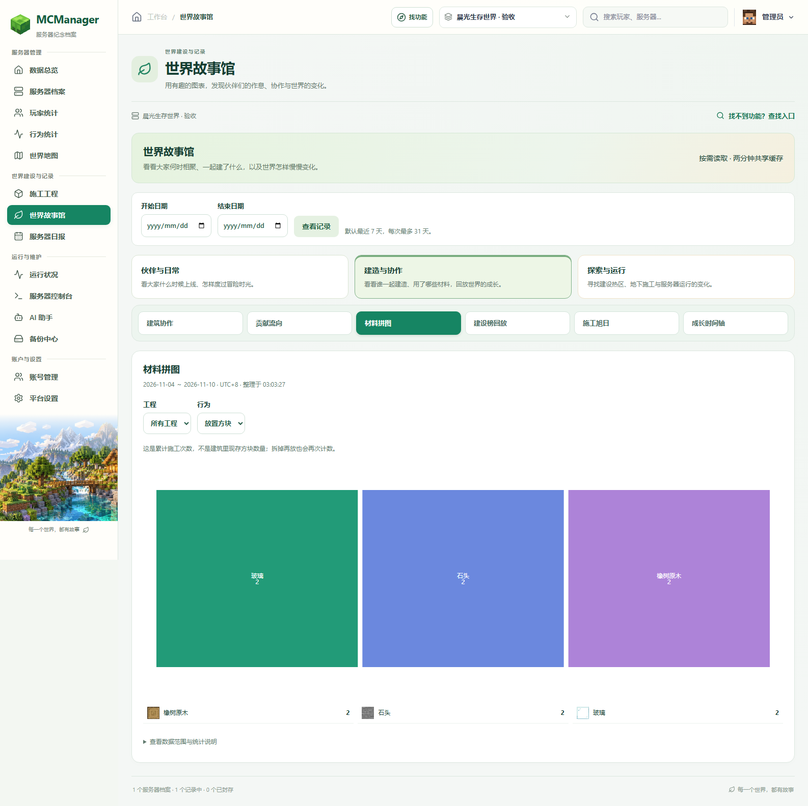
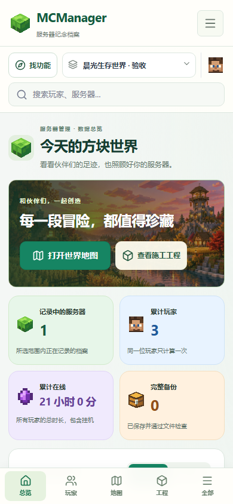
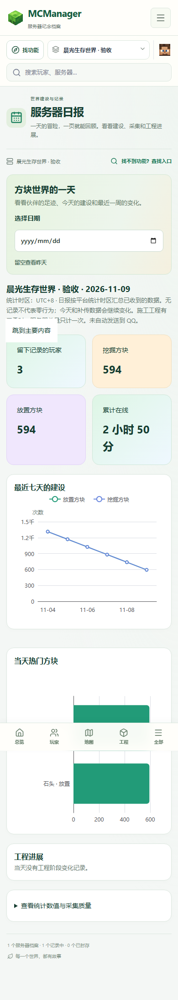

<div align="center">

# MCManager Archive

### 每一段冒险，都值得珍藏。

**为 Minecraft 基岩版服务器打造的自托管档案馆。**

看见玩家的足迹，记录一起建造的世界，让 AI 理解服务器里发生的故事。

[快速开始](docs/getting-started.md) · [功能一览](docs/features.md) · [部署指南](docs/deployment.md) · [MCP 接入](mcp/README.md) · [English](README.en.md)

[](https://github.com/wy708/MCManager-archive/actions/workflows/ci.yml)


[下载预发布版](https://github.com/wy708/MCManager-archive/releases) · [反馈问题](https://github.com/wy708/MCManager-archive/issues)

</div>



> 截图来自独立演示数据。背景是主题插画，不是服务器地图；示例名称、玩家和数值均不来自生产环境。

## 不只是一个控制面板

服务器的价值，也藏在「谁一起盖了这座房子」「这个世界什么时候最热闹」「那一箱材料是谁放进去的」里面。MCManager 把已经采集到的这些记录整理成可以浏览、查询和分享的故事。

| 你想知道什么 | 可以怎么做 |
| --- | --- |
| 大家最近都在玩什么？ | 查看在线趋势、行为排行、UTC+8 日报和玩家档案 |
| 这座建筑是谁一起盖的？ | 创建施工工程，按范围汇总所有贡献者、材料与阶段 |
| 想把建筑分享给朋友？ | 分享公开工程链接，查看二维区域与三维场景 |
| 谁动过这个箱子？ | 按坐标查询已记录的容器操作，保留时间和归属边界 |
| 游戏卡，是主机还是服务端？ | 对照整机 CPU、内存、磁盘、网络与游戏进程指标 |
| 想让 AI 帮忙照看世界？ | 给 Agent 独立权限，通过 MCP 查询、关联历史或回复聊天 |
| 怕世界丢失？ | 按服务器管理世界备份、每日时间计划、下载与恢复任务 |

### 一起建造，也一起留下名字

用游戏命令或已绑定身份的 AI 创建工程，指定水平范围，统计所有高度。可以改范围、封存、继续；所有玩家在范围内已确认的建造行为都计入贡献。管理员可删除工程，公开访客只能查看。



### 把数字变成世界的故事

14 类图表按伙伴日常、建造协作、探索运行分组：作息热力图、活动河流、关系网络、贡献桑基图、材料矩形树图、建设热区、施工旭日图、排行榜回放等。保留数值明细和口径说明，不把「没有记录」当成「从未发生」。

<details>
<summary>展开材料拼图与手机界面</summary>






</details>

### AI 能查证，再回答

MCP 支持统计、聊天、世界观测、容器记录、施工项目、日报、种子群系与结构候选查询。组合地点查询分别返回**自然环境预测**和**有时间戳的历史实测**，避免把旧记录说成当前事实。

可选 `/ai` 桥接把游戏消息交给现有 DSH / QQ 群会话，并标注消息来自游戏。共享记忆来自已配置的 DSH 会话；MCManager 不附赠模型服务或 API 额度。

## 快速开始

需要 Docker Engine 与 Compose v2。先下载源码，进入项目根目录：

```sh
python3 scripts/configure.py --public-url http://localhost:8088
docker compose up -d --build
```

打开 `http://localhost:8088`。初始化账号信息保存于只供部署者读取的 `.env`，不要提交或分享。首次构建会下载并校验固定版本的场景与地形依赖，耗时明显长于以后启动。

网页启动后，在「服务器档案」创建档案，再到「平台设置 → 游戏插件连接」配置采集器。**启动网页不会自动获得游戏数据。** 游戏端版本、地图部署与公网 HTTPS 配置见 [快速开始](docs/getting-started.md) 和 [兼容矩阵](docs/compatibility.md)。

## 面向真实服务器的设计

- **多服隔离**：凭据、工程、数据和查询范围按服务器绑定。
- **断线可补传**：磁盘队列、稳定事件编号、批量传输与后端幂等，保留缺口与失败状态。
- **按需展示**：页面分包，图表接近视口才初始化；首页不加载三维模型，不轮询所有服务器。
- **有边界的三维处理**：共享转换队列、场景缓存、按高度读取；导出前确认 Y 范围。
- **权限分离**：管理员与只读账户、独立 Agent 权限、公开地图与私有管理接口分离。
- **可解释数据**：估算值、观测时间、算法版本和能力覆盖有明确标记。

这不是「零开销」插件。大型区域采集、场景转换和大量历史数据需要资源规划，详见 [性能与边界](docs/performance.md)。

## 项目结构

```text
frontend/          Vue 工作台、公开工程页、图表与三维浏览器
backend/           Spring Boot API、权限、数据库迁移、任务调度
collector/         Windows BDS 原生采集器与精确版本兼容层
backup/            游戏主机执行端、世界快照、归档与恢复
mcp/               独立 stdio MCP 服务
integrations/dsh/  可选游戏 /ai 与现有 QQ 会话桥接
map/               MipMap 接入、版本固定与兼容补丁
scene/             MiEx 场景转换、资源版本与补丁
terrain/           基岩版种子预测引擎适配
scripts/           构建、部署、发布与验证入口
docs/              使用文档、架构、协议与演示截图
```

[架构与数据流](docs/architecture.md) · [下载与发布](docs/releases.md) · [开发与测试](docs/testing.md) · [贡献指南](CONTRIBUTING.md) · [安全策略](SECURITY.md) · [更新记录](CHANGELOG.md)

## 当前阶段与限制

这是 **0.7.0-preview.2 预发布**。Windows BDS 原生接口严格绑定精确版本，目前以 `1.26.61.1` 配置为主要功能路径；`1.26.51.1` 旧配置保留，但并不拥有新配置的全部功能。不要将插件直接用于任意新版服务端。

世界观测受加载区块和采集时间限制；种子结构输出是候选位置，不能代表玩家改造后的世界。三维预览对无法还原的资源报告缺失，尚不承诺所有自定义资源包。`/ai` 与实际 DSH 环境仍需独立联调。已完成检查与未覆盖范围见 [验证说明](docs/testing.md)。

## 致谢与许可

感谢 [LeviLamina](https://github.com/LiteLDev/LeviLamina)、[Endstone](https://github.com/EndstoneMC/endstone)、[MipMap](https://github.com/MipaSenpai/MipMap)、[MiEx](https://github.com/BramStoutProductions/MiEx)、[cubiomes-bedrock](https://github.com/FragrantResult186/cubiomes-bedrock)，以及 Vue、ECharts、Three.js、Leaflet 等项目。

原创代码采用 [MIT](LICENSE)。第三方代码、游戏材质和品牌不包含在该授权内，见 [第三方声明](THIRD_PARTY_NOTICES.md)。本项目非 Minecraft / Mojang / Microsoft 官方产品，与其没有隶属或认可关系。

如果这个档案馆对你的服务器有帮助，欢迎 Star、提交问题，或分享使用体验。比起功能数量，我们更在乎记录准确、世界安全，以及伙伴们玩得开心。
