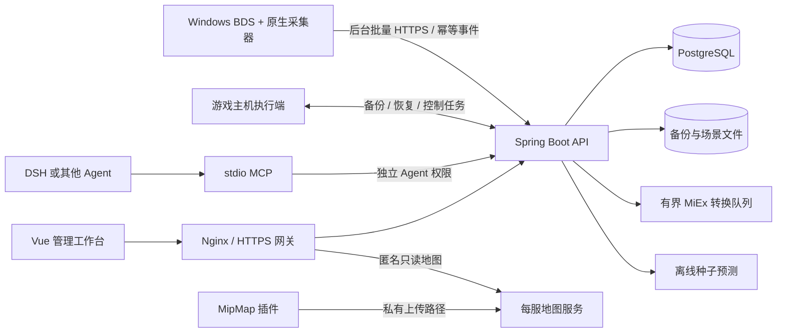

# 架构与数据流

## 代码边界

前端不直接读取游戏文件。API 负责身份、档案隔离、查询范围、任务状态和数据留存。原生采集器只在需要游戏对象时访问游戏线程，磁盘、网络和等待在后台处理。独立执行端负责进程生命周期与文件任务。

统计汇总与逐条明细分开保存；查询使用范围、分页和保留策略。重试保留原事件/请求编号，不能靠重复插入「修复」不确定状态。

## 世界观测与预测

在线世界查询通过有界任务请求采集器读取已加载区域。离线历史保留原观测时间。种子引擎只计算自然环境/结构候选，不读取玩家建设；组合查询并列返回各来源与失败状态。

## 工程场景

工程范围是水平 X/Z，采集涵盖可用高度。平台从已收到的分段快照生成场景，网页按选定 Y 范围读取几何。施工起点只是默认显示范围，不删除地下数据。封存固定阶段，继续施工开启新阶段。

## 安全边界

管理账户、采集器、Agent 与主机执行端使用不同凭据。MCP 不提供任意文件读取或任意控制台命令。公共地图/工程有单独的匿名读取接口，不能据此访问管理或模型导出接口。

协议细节：[采集](采集协议.md)、[Agent](Agent接口与回复队列.md)、[备份](远程备份任务协议.md)、[恢复](恢复任务协议.md)。
